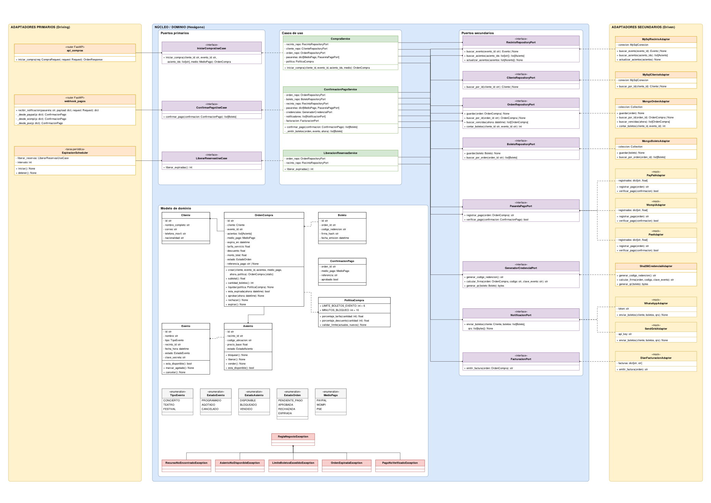

# StagePass Live — Arquitectura Hexagonal

Taller de Arquitectura de Software (UNAB). Plataforma de venta de boletería implementada con Python + FastAPI siguiendo puertos y adaptadores.

**Docente:** MSc. Feisar Moreno

**Integrantes:**
- Edwar Alejandro Jiménez Ríos

## Diagrama de clases

Archivo editable: [`docs/StagePassLive_Hexagonal.drawio`](docs/StagePassLive_Hexagonal.drawio) (se abre en draw.io o en VS Code con la extensión *Draw.io Integration*).



## Estructura

```
app/
├── core/                      ← NÚCLEO (solo Python estándar, sin frameworks)
│   ├── domain/                  entidades, enums, PoliticaCompra, excepciones
│   ├── ports/entrada/           puertos primarios (casos de uso)
│   ├── ports/salida/            puertos secundarios (repositorios y servicios externos)
│   └── use_cases/               CompraService, ConfirmacionPagoService, LiberacionReservasService
├── adapters/
│   ├── entrada/                 API de compras, webhook de pagos, scheduler de expiración
│   └── salida/                  MySQL, MongoDB, PayPal/Wompi/PSE, SHA-256+QR, WhatsApp, SendGrid, DIAN
├── config.py                  conecta adaptadores con el núcleo
└── main.py                    app FastAPI
docs/                          diagrama UML (.drawio) y vista previa
tests/                         pruebas de reglas de negocio, API y arquitectura
sql/init.sql                   tablas y datos de ejemplo de la BD legacy
```

## Adaptadores

| Adaptador | Estado |
|---|---|
| MySQL (recintos, asientos, clientes) | Implementado |
| MongoDB (órdenes y boletos) | Implementado |
| Credenciales (HMAC-SHA256 + QR) | Implementado |
| PayPal, Wompi, PSE | Mock |
| WhatsApp, SendGrid | Mock |
| DIAN | Mock |

## Cómo correrlo

En Windows basta con doble clic, en orden, sobre:

1. `1_instalar.bat` – crea el entorno virtual e instala dependencias
2. `2_pruebas.bat` – corre las pruebas
3. `3_correr_api.bat` – levanta MySQL y MongoDB (Docker Desktop abierto) y la API
4. `4_demo_sin_docker.bat` – la misma API con datos en memoria, sin Docker (solo para probar)

O manualmente:

```bash
docker compose up -d                 # MySQL (con datos de ejemplo) y MongoDB
python -m venv .venv
.venv\Scripts\activate
pip install -r requirements.txt
uvicorn app.main:app --reload
```

Documentación interactiva en http://localhost:8000/docs

### Ejemplo

1. Iniciar compra:
```json
POST /compras
{"cliente_id": "CLI-001", "evento_id": "EV-001", "asiento_ids": ["A-01", "A-05", "A-06"], "medio_pago": "PAYPAL"}
```
2. Simular la notificación de la pasarela (usar `orden_id` y `referencia_pago` de la respuesta anterior):
```json
POST /webhooks/pagos/paypal
{"orden_id": "...", "referencia": "PAYPAL-...", "status": "COMPLETED"}
```

Formatos de Wompi y PSE en `app/adapters/entrada/webhook_pagos.py`.

## Pruebas

```bash
python -m pytest
```

Incluye una prueba que revisa que ningún archivo de `app/core` importe librerías externas.
